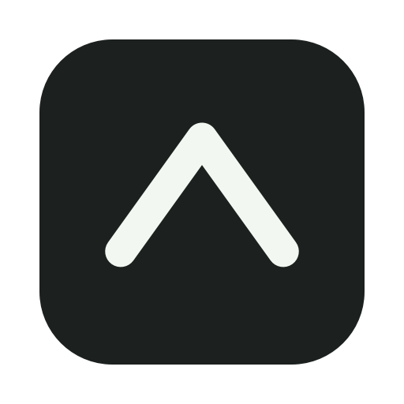
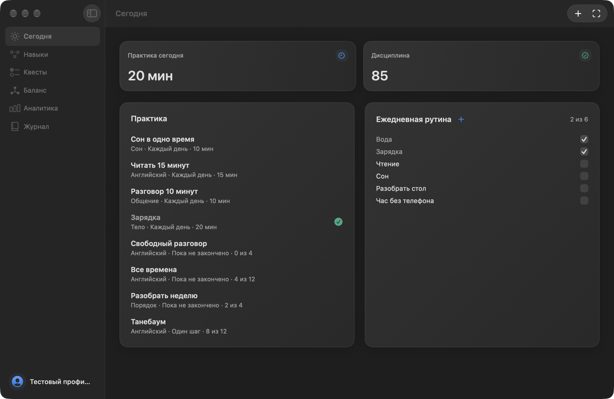

<h1> ASCEND</h1>

Локальная система развития для macOS. Квесты, привычки, сессии и навыки хранятся на этом компьютере. Аккаунт, сервер и подписка не нужны.

Интерфейс на русском и английском. Сборка для Apple Silicon, macOS 13 и новее.

## Что делает

**Сегодня** собирает день в одном месте. Сначала идут привычки на каждый день, затем задачи «пока не закончено», затем один шаг длинного проекта. Рядом — ежедневная рутина: список составляется заранее, отметки живут только этот день.

**Навыки** связаны зависимостями и копят опыт. У навыка есть свои квесты. Сессия идёт по таймеру и записывается в историю; после выхода или сбоя она возвращается на паузе, время вне приложения не начисляется.

**Квесты** бывают трёх видов: «Каждый день», «Пока не закончено» и «Один шаг». У задачи есть план сессий, срок и результат.

**Персонаж** показывает уровень, опыт и шесть характеристик. Седьмая, дисциплина, стоит числом рядом с ними. Этапы открываются отдельной кнопкой.

Данные лежат в `~/Library/Application Support/ASCEND/`. База — SQLite. Резервные копии, JSON и CSV есть в настройках. Импорт сначала показывает, что внутри файла, и перед заменой сохраняет текущую базу. Сеть не используется.

## Снимки

Сегодня: практика дня и рутина.



Навыки: опыт, зависимости и подтверждённый результат.


Квесты: список, срок и запуск сессии.


На снимках тестовый профиль. Свой профиль при первом запуске пустой.

## Запуск

Готовая сборка: [ASCEND 0.6.0 для Apple Silicon](https://github.com/rixct/ascend/releases/tag/v0.6.0). Файл подписан локально, поэтому при первом открытии macOS попросит подтвердить запуск.

Сборка из исходников:

```sh
./scripts/build-app.sh
open dist/ASCEND.app
```

Нужны Xcode Command Line Tools и Rust stable. Если Cargo ещё нет, `scripts/setup.sh` ставит его в `.toolchain/`. Каталоги `target/`, `dist/` и `.toolchain/` остаются на машине.

Отдельная база, чтобы не открывать свой профиль:

```sh
open -n dist/ASCEND.app --args --data-dir /absolute/path/to/test-profile
```

## Устройство

| Путь | Назначение |
| --- | --- |
| `native/Sources/` | SwiftUI и AppKit: окна, экраны, настройки |
| `native/Resources/` | Русские и английские строки |
| `crates/ascend-core/` | Опыт, уровни, дисциплина, баланс |
| `crates/ascend-storage/` | SQLite, копии, JSON и CSV |
| `crates/ascend-planner/` | План дня и рекомендации |
| `crates/ascend-bridge/` | Локальный процесс, с которым говорит интерфейс |

Интерфейс не считает опыт сам. Все команды идут в `ascend-engine` через stdin/stdout и проходят одну и ту же проверку.

Подробнее: [рутина](docs/ROUTINE.md), [сессии](docs/SESSIONS.md), [дерево навыков](docs/SKILL_TREE.md), [дерево квестов](docs/QUEST_TREES.md), [строгий режим](docs/STRICT_MODE.md), [уведомления](docs/NOTIFICATIONS.md).

Проверки:

```sh
./scripts/cargo.sh test --workspace --locked
./scripts/cargo.sh clippy --workspace --all-targets --locked -- -D warnings
./scripts/cargo.sh fmt --all --check
```

106 тестов Rust покрывают формулы, повторные начисления, привычки, зависимости и SQLite. Те же проверки запускает GitHub Actions.

Лицензия — [MIT](LICENSE).
