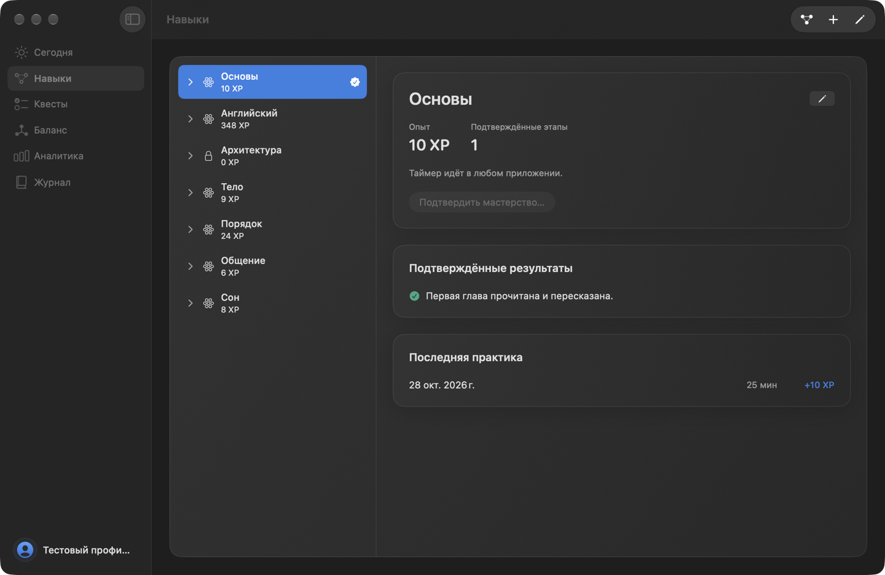
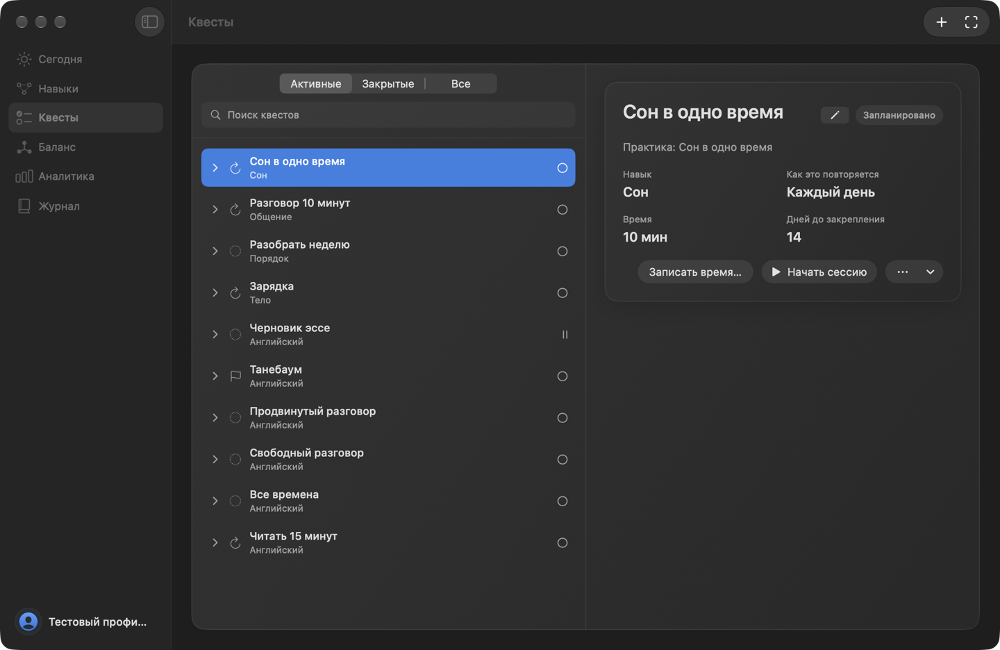

<h1> ASCEND</h1>

A local personal-development app for macOS. Quests, habits, sessions, and skills stay on this computer. No account, server, or subscription.

The interface is in English and Russian. The build is for Apple Silicon and macOS 13 or later.

## What it does

**Today** puts the day in one place. Habits come first, then work that continues until it is done, then the next step of a longer project. The daily routine sits beside that: the list is set in advance, and the checks last only for today.

**Skills** are linked by prerequisites and collect experience. Each skill has its own quests. A session runs on a timer and is written into the history. After you quit or the app stops, the session comes back paused. Time spent outside the app is not counted.

**Quests** are one of three kinds: every day, until it is done, or one step. A quest can have a session plan, a deadline, and a result.

**Character** shows level, experience, and six attributes. Discipline, the seventh, is a number beside them. Milestones open from their own button.

Data lives in `~/Library/Application Support/ASCEND/`. The database is SQLite. Backups, JSON, and CSV are in Settings. Import shows what a file contains, and the current database is copied before it is replaced. The app does not use the network.

## Screenshots

A new profile, before any skills or quests.

Today.


Skills.



Quests.



## Run

Download [ASCEND 0.8.0 for Apple Silicon](https://github.com/rixct/ascend/releases/tag/v0.8.0). The app is signed locally, so macOS asks you to confirm the first launch.

Build from source:

```sh
./scripts/build-app.sh
open dist/ASCEND.app
```

You need the Xcode Command Line Tools and Rust stable. If Cargo is not installed, `scripts/setup.sh` puts it in `.toolchain/`. The `target/`, `dist/`, and `.toolchain/` directories stay on your machine.

Open a separate database instead of your own profile:

```sh
open -n dist/ASCEND.app --args --data-dir /absolute/path/to/test-profile
```

## Layout

| Path | Role |
| --- | --- |
| `native/Sources/` | SwiftUI and AppKit: windows, screens, settings |
| `native/Resources/` | English and Russian strings |
| `crates/ascend-core/` | Experience, levels, discipline, balance |
| `crates/ascend-storage/` | SQLite, backups, JSON and CSV |
| `crates/ascend-planner/` | The daily plan and recommendations |
| `crates/ascend-bridge/` | The local process the interface talks to |

The interface does not calculate experience itself. Every command goes to `ascend-engine` through stdin/stdout and through the same checks.

More detail: [routine](docs/ROUTINE.md), [sessions](docs/SESSIONS.md), [skill tree](docs/SKILL_TREE.md), [quest trees](docs/QUEST_TREES.md), [strict mode](docs/STRICT_MODE.md), [notifications](docs/NOTIFICATIONS.md).

Checks:

```sh
./scripts/cargo.sh test --workspace --locked
./scripts/cargo.sh clippy --workspace --all-targets --locked -- -D warnings
./scripts/cargo.sh fmt --all --check
```

106 Rust tests cover the formulas, repeated awards, habits, prerequisites, and SQLite. GitHub Actions runs the same checks.

License: [MIT](LICENSE).
